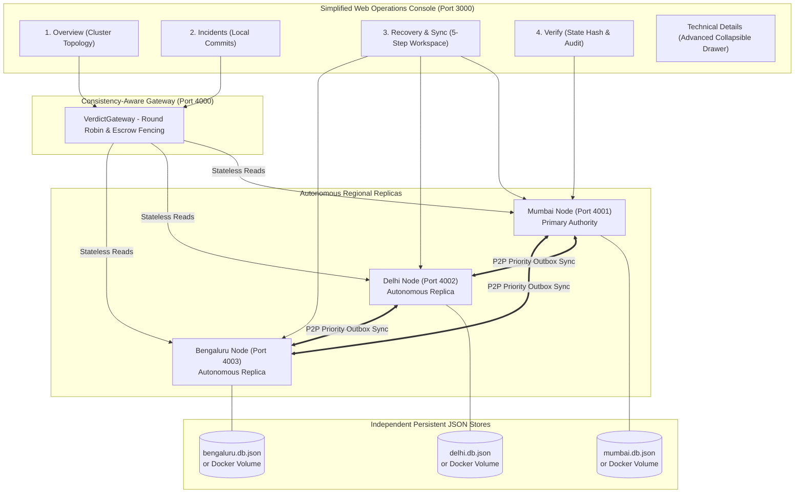

# VERDICT — Simplified System Architecture & Information Flow

**Project:** VERDICT — Geo-Distributed Disaster Data Replication with Graceful Degradation  
**Hackathon:** CodeAstra 2.0 (Problem Statement #2: Cloud Computing & Distributed Systems)  
**Team:** `print("Winners");`  
**Deployment Scope:** Local Multi-Process & Dockerized Multi-Container Topology  

---

## 1. High-Level Architecture Overview

VERDICT is built around a single unifying lifecycle:

$$\text{Incident} \longrightarrow \text{Network Partition} \longrightarrow \text{Local Autonomy} \longrightarrow \text{Reconciliation} \longrightarrow \text{Verification}$$

The simplified architecture decouples the operator dashboard into four intuitive sections while retaining all underlying distributed guarantees across three autonomous regional replicas:

---

## 2. Information Architecture (The 4 Primary Views)

1. **Overview (`OverviewView`):**
   - High-level system vitals: Network state, tracked incidents, pending outbox queue, competing claims.
   - 3-Card regional topology connected with live status indicators (`HEALTHY`, `SYNCING`, `REVIEW REQUIRED`, `DISCONNECTED`).
   - Fast access to Guided Demo.
2. **Incidents (`IncidentsView`):**
   - Unified record list across regional nodes.
   - Incident submission form injecting stable UUIDv4 `clientTxId` for duplicate prevention.
   - Shows receiving node, local disk acknowledgement, and causal vector state.
3. **Recovery & Sync (`RecoverySyncView`):**
   - The primary demo screen for judges.
   - Large prominent network partition status banner.
   - 5-step guided walkthrough:
     - Step 1: Create Incident
     - Step 2: Cut Network Link
     - Step 3: Local Write in Partition
     - Step 4: Restore Link
     - Step 5: Sync & Verify
4. **Verify (`VerifyView`):**
   - Single clear verdict badge: `VERIFIED`, `REVIEW REQUIRED`, `DEGRADED`, or `UNAVAILABLE`.
   - 4 Inspection Pillars: Reachability, Outbox status, Conflict review, and Cryptographic integrity (Ed25519 signatures, SHA-256 op chain, and Canonical State Hashes).
   - Plain-English expandable explanation of distributed mechanisms.

---

## 3. Preserved Distributed-Systems Guarantees

- **Autonomous Local Persistence:** Writes are immediately committed to disk via atomic file writes (`.tmp` to `.json`) without requiring cross-region consensus.
- **Escrow Bounded Fencing:** Operations consuming spatial supplies (`POST /api/v1/escrow/spend`) are strictly bound to local regional quotas, mathematically preventing budget over-allocation during network splits.
- **Causal Version Vectors:** Concurrent conflicting updates branch into competing claims preserved side-by-side in `conflicts[]` rather than suffering silent last-write-wins overwrites.
- **Cryptographic Chaining & Signing:** Every operation is hashed via SHA-256 into a cryptographic chain and signed using Ed25519.
- **Deterministic Convergence:** Reconnection drains outbox queues in priority order (`EMERGENCY` > `HIGH` > `STANDARD` > `BULK`) and verifies bit-level consensus via `GET /api/v1/consistency/state-hash`.
