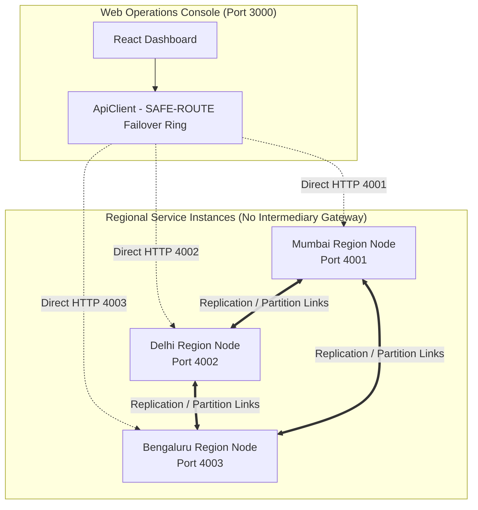

# VERDICT — Current Request Path & Load Balancing Architecture Audit

**Project:** VERDICT — Geo-Distributed Disaster Data Replication with Graceful Degradation  
**Hackathon:** CodeAstra 2.0 (Problem Statement #2)  
**Team:** `print("Winners");`  
**Classification:** Pre-Implementation Baseline Audit vs. Implemented Gateway Layer  

---

## 1. Executive Findings: What Existed Prior to the Load Balancer

Prior to the implementation of the consistency-aware gateway layer, the VERDICT system operated with a **direct client-to-region connection topology**:

1. **Browser Direct Connections:** The React frontend ([Shell.tsx](file:///c:/Users/Rohit%20Patil/OneDrive/Documents/Final_PrintWinners/packages/web/src/components/Shell.tsx)) communicated directly with regional Fastify service processes running on localhost loopback ports:
   - Mumbai: `http://localhost:4001`
   - Delhi: `http://localhost:4002`
   - Bengaluru: `http://localhost:4003`
2. **Absence of Shared Reverse Proxy / Gateway:** There was no NGINX, HAProxy, AWS ALB, or Node.js reverse proxy intermediary between the browser and regional instances.
3. **Client-Side Fallback Rings (SAFE-ROUTE):** The frontend [ApiClient](file:///c:/Users/Rohit%20Patil/OneDrive/Documents/Final_PrintWinners/packages/web/src/api/client.ts) managed failover reactively:
   - Mumbai ring: `mumbai -> delhi -> bengaluru`
   - Delhi ring: `delhi -> mumbai -> bengaluru`
   - Bengaluru ring: `bengaluru -> mumbai -> delhi`
   When a connection refused or a 5xx error occurred, the client sequentially attempted the next node in the ring.
4. **No Traffic Distribution (No Load Balancing):** All requests from an operator viewing Mumbai were sent exclusively to port 4001 until port 4001 died. Traffic was not distributed among healthy peers.

---

## 2. Why Naive Load Balancing Was Omitted (The Consistency Hazard)

In classical stateless web applications, a Layer-4 or Layer-7 load balancer (e.g., Round-Robin NGINX) simply distributes requests evenly across all running backends.

In a **geo-distributed data replication system with graceful degradation**, naive round-robin routing causes immediate data corruption:
- **Spatial Escrow Quota Violations:** In VERDICT, emergency supply budgets (medical kits, evacuation food packs) are allocated to specific regional authorities (`EscrowAccount`). If an escrow spend request targeting Mumbai is randomly load-balanced to Delhi, Delhi either rejects it with `EscrowQuotaFenceError` or mistakenly attempts to deduct from Delhi's local quota.
- **Concurrent Conflict Inflation:** If two rapid updates to the same entity (e.g. `access-corridor-north`) are round-robined across Mumbai and Delhi during a network partition, both regions create independent causal vector branches ($V_A \parallel V_B$), inflating unnecessary conflicts that require human reviewer sign-off.
- **Causal Sticky Reads:** If an operator posts an incident report to Mumbai and their next read is routed to Delhi before asynchronous peer replication has completed, the operator experiences time-travel inconsistency (reading their own stale data).

---

## 3. Pre-Implementation Architectural Topology

---

## 4. Summary of Existing Failover vs. Load Balancing Needs

| Requirement | Existing Pre-Implementation State | Load-Balancing Requirement |
| :--- | :--- | :--- |
| **Failover** | Implemented via `FALLBACK_RINGS` in `client.ts` | Retain client resilience; complement with gateway-level failover. |
| **Load Balancing** | **Absent.** All traffic directed to selected region. | Implement deterministic round-robin across healthy nodes for eligible reads. |
| **Consistency Guard** | Handled by manual region selection in UI. | Enforce protocol-level checks preventing sensitive writes from being load-balanced. |
| **Diagnostics** | Visible per-region status in `RegionsView.tsx`. | Expose gateway-level load balancing stats and serving region headers. |
