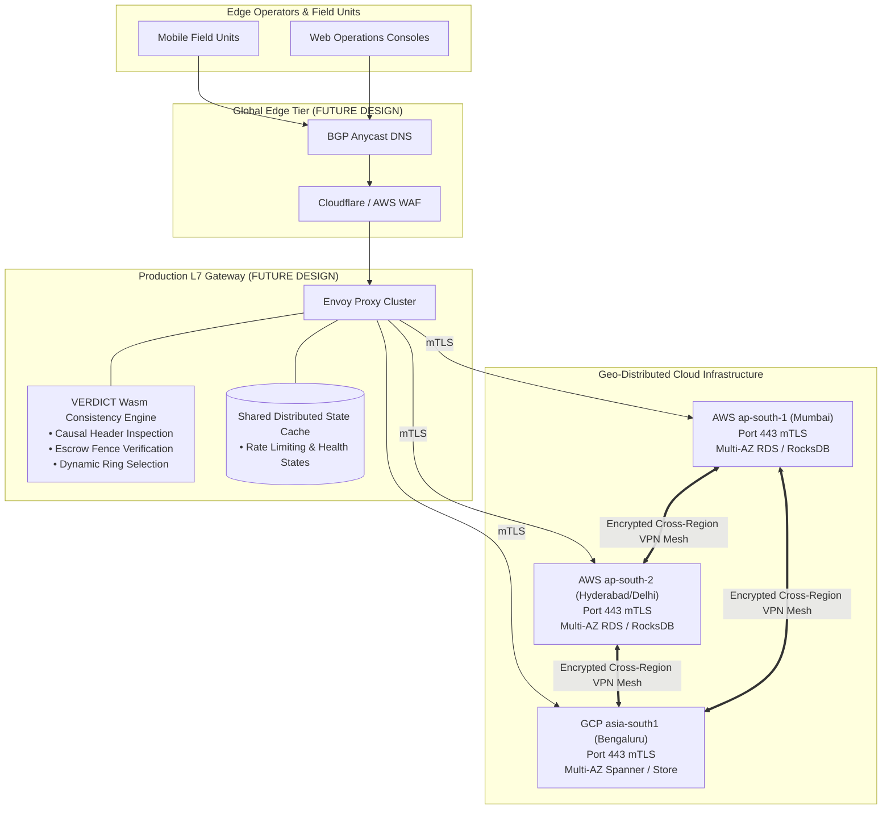

# VERDICT — Load Balancer Limitations & Production Blueprint

**Project:** VERDICT — Geo-Distributed Disaster Data Replication with Graceful Degradation  
**Classification:** Prototype Simulation Scope vs. Enterprise Production Architecture  

---

## 1. Current Prototype Limitations (Mandatory Disclosures for Judges)

To maintain absolute academic and engineering honesty, the following constraints must be disclosed during presentations:

1. **Local Multi-Process Gateway, Not Physical Cloud Hardware:**
   - The gateway (`VerdictGateway`) runs on local port 4000 as a Fastify process.
   - It proxies traffic over loopback interfaces (`127.0.0.1:4001..4003`) rather than physical wide-area networks or cross-datacenter leased lines.
2. **In-Memory Routing State:**
   - Metrics, health counters, and round-robin indexes are stored in Node.js process memory.
   - If the gateway process crashes and restarts, cumulative request counters reset to zero (though backend regional databases remain fully intact on disk).
3. **No TLS / SSL Offloading:**
   - Communication between the web client, gateway, and regional services is plaintext HTTP over loopback.
   - Production requires TLS certificate termination and mutual TLS (mTLS) between gateway and regional nodes.
4. **Simple Health Probing vs. Complex Gray-Failure Detection:**
   - Health checks evaluate binary HTTP 200 reachability and socket timeouts.
   - The current gateway does not perform advanced statistical outlier detection or TCP flap dampening.
5. **No Edge Anycast Routing:**
   - Clients resolve the gateway at `http://localhost:4000`.
   - Production requires BGP Anycast DNS routing to steer edge users to their closest geographical gateway.

---

## 2. Production Architecture: Future Design Blueprint

In a production disaster management deployment across India or globally, the lightweight Node.js gateway would be replaced by an enterprise **L7 Service Mesh / Edge Proxy (Envoy / HAProxy)** equipped with custom WebAssembly (Wasm) filters implementing VERDICT's consistency policies.

### Target Production Topology (FUTURE DESIGN)

---

## 3. What Needs to Change for Production Deployment

| Dimension | Current Local Simulation | Production Requirement (FUTURE DESIGN) |
| :--- | :--- | :--- |
| **Proxy Engine** | Fastify in Node.js | Envoy Proxy with C++ / Rust WebAssembly filter. |
| **Security** | Plaintext HTTP loopback | TLS 1.3 edge termination + mTLS internal mesh. |
| **High Availability**| Single gateway process on port 4000 | Active-Active redundant gateway instances with keepalived / ECMP. |
| **Health Probes** | Sequential HTTP `/api/v1/status` | Active L4 TCP SYN + L7 deep synthetic transaction probes. |
| **DDoS & Rate Limiting**| Unrestricted local calls | Token-bucket rate limiting per field officer API key. |
| **Persistence** | Atomic JSON files on local disk | Distributed LSM-tree (RocksDB) or geo-replicated CockroachDB/PostgreSQL. |
