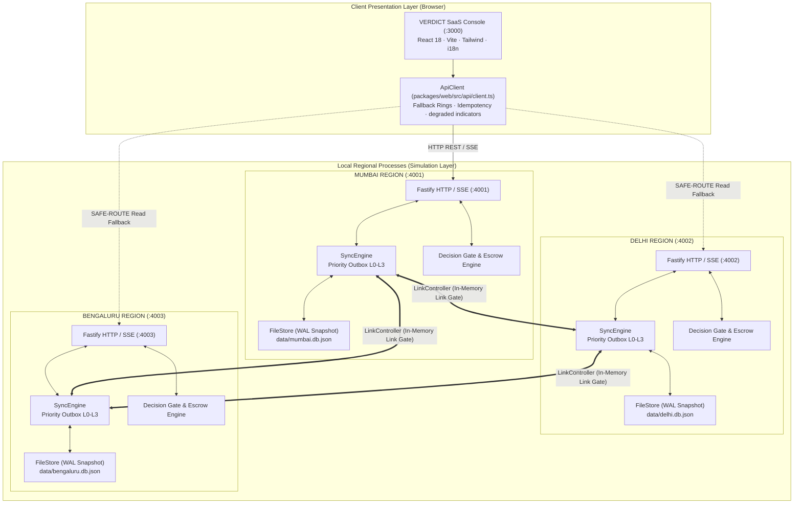

# VERDICT — System Overview & Architecture

**Project:** VERDICT — Geo-Distributed Disaster Data Replication with Graceful Degradation  
**Hackathon:** CodeAstra 2.0 (Problem Statement #2)  
**Team:** `print("Winners");`  
**Classification:** Local Multi-Process Simulation (Not Cloud/AWS Multi-Region Deployment)

---

## 1. Problem Statement & Core Thesis

### Problem Statement #2 Brief
> "Design a multi-region data service prototype with local write capability, synchronization after partition, and a defined conflict-resolution policy. Demonstrate what happens when regions disagree and connectivity is restored."

### The VERDICT Thesis
In disaster response and emergency relief operations, distributed partitions and network link failures are guaranteed. Conventional distributed databases prioritize either total consistency (CP: locking writes until global quorum agrees, halting field responders) or uncontrolled eventual consistency (AP: accepting conflicting writes and silently discarding one via Last-Write-Wins timestamps).

VERDICT introduces **Decision-Aware Operational Consistency**:
1. **Never stall field observations:** Field reports and damage assessments are accepted unconditionally offline, signed locally via Ed25519, and chained into an append-only log.
2. **Never silently overwrite truth:** Concurrent conflicting observations are causally detected using version vectors, preserved side-by-side, and held for authorized reviewer adjudication.
3. **Safe by construction commitments:** Scarce consumable resources (medical kits, rescue boats) use **Escrow bounded counters** ($\sum \text{spent} \le \text{Total}$), preventing over-allocation during network partitions without cross-region locks.
4. **Deterministic Decision Gate:** High-stakes field dispatches pass through a local 7-check gate yielding **`GO`**, **`CAUTION`**, or **`HOLD`**, informing responders of the exact reliability of current local knowledge.

---

## 2. System Architecture & Topology

The VERDICT prototype is implemented as a multi-region distributed system simulated across independent OS processes communicating over HTTP and Server-Sent Events (SSE).

---

## 3. Technology Stack

| Layer | Technologies Used | Responsibility |
| :--- | :--- | :--- |
| **Monorepo Architecture** | npm Workspaces (`packages/*`), TypeScript 5.5, Node.js 20+ | Multi-package workspace modularity |
| **Core Invariant Engine** (`@verdict/core`) | TypeScript, `@noble/hashes` (SHA-256), `@noble/ed25519` | Pure deterministic decision gate, vector math, CRDT folding, canonical hashing, escrow counters |
| **Regional Service** (`@verdict/region-service`) | Fastify 4.28, `@fastify/cors`, `@fastify/swagger` | Regional node daemon, transactional outbox, link gate, SSE streaming, persistence |
| **Frontend Dashboard** (`@verdict/web`) | React 18, Vite 5.4, Tailwind CSS, Lucide React, Leaflet, i18next | SaaS operations console, map rendering, gate cockpit, failover badge, lab verification |
| **Local Persistence** | JSON-WAL snapshot store (`FileStore`) | Dedicated isolated regional database files in `data/*.db.json` |
| **Test Framework** | Vitest 2.0, `fast-check` (property-based testing) | Unit, integration, and end-to-end failover test suites |

---

## 4. Regional Node Roles & Configuration

Defined in [`config/regions.json`](file:///c:/Users/Rohit%20Patil/OneDrive/Documents/Final_PrintWinners/config/regions.json):

1. **Mumbai (`mumbai`, Port 4001):**
   - Designated **Territory Authority** for Western Sector disaster corridors.
   - Authority for access corridors (`access-corridor-north`, `corridor-alpha`).
   - Default initial escrow allocation: 6 / 10 medical kits.
2. **Delhi (`delhi`, Port 4002):**
   - Regional Logistics Node for Northern Sector.
   - Non-authority peer for Mumbai territory assets; authority for northern shelters.
   - Default initial escrow allocation: 4 / 10 medical kits.
3. **Bengaluru (`bengaluru`, Port 4003):**
   - Field Logistics Node for Southern Sector.
   - Serves as tertiary fallback replica in deterministic failover rings.

---

## 5. Architectural Reality & Simulation Classification

To maintain scientific honesty when presenting to judges and technical reviewers:

1. **Local Multi-Process Simulation:**
   - The nodes do **not** run in distinct AWS/GCP cloud regions. They run as independent OS processes listening on loopback ports `4001`, `4002`, and `4003`.
   - Network partitions, latencies, and packet drops are simulated deterministically using an in-process `LinkController` software gate.
2. **Local File Persistence:**
   - Storage is file-backed JSON (`data/mumbai.db.json`, `data/delhi.db.json`, `data/bengaluru.db.json`) serialized via serialized file locking (`this.saveLock`). It is not an enterprise distributed SQL database.
3. **Honest Standby Recovery:**
   - Recovery tests demonstrate process crash recovery and standby file restoration. They do not demonstrate geographic cross-continental cloud failover.
