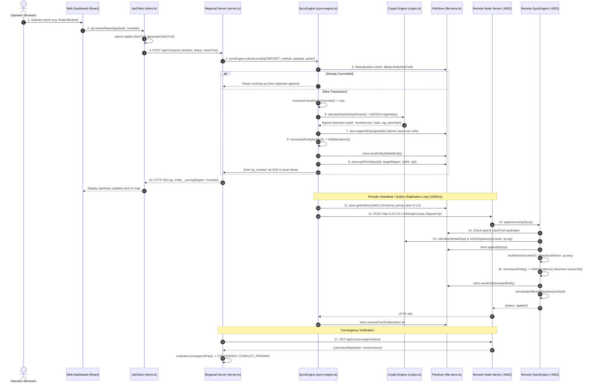

# VERDICT — End-to-End Workflow & Execution Trace

This document details the exact runtime sequence of a real request in VERDICT, tracing from the first user click in the web dashboard to final cross-replica cryptographic convergence.

---

## 1. Complete 17-Step Request Lifecycle Diagram



---

## 2. Step-by-Step Technical Execution Breakdown

### Step 1: Operator Action in the Web Dashboard
- **File:** [`packages/web/src/views/MapView.tsx`](file:///c:/Users/Rohit%20Patil/OneDrive/Documents/Final_PrintWinners/packages/web/src/views/MapView.tsx) or [`packages/web/src/views/GateView.tsx`](file:///c:/Users/Rohit%20Patil/OneDrive/Documents/Final_PrintWinners/packages/web/src/views/GateView.tsx)
- **User Action:** The operator selects an entity (e.g. `access-corridor-north`), changes the status to `BLOCKED`, and clicks **Submit Report**.
- **Failure Case:** Form validation prevents empty payloads.

### Step 2: Frontend API Client & Target Region Selection
- **File:** [`packages/web/src/api/client.ts`](file:///c:/Users/Rohit%20Patil/OneDrive/Documents/Final_PrintWinners/packages/web/src/api/client.ts)
- **Function:** `ApiClient.submitReport(payload, region)` &rarr; `writeWithIdempotency(path, payload, preferredRegion)`
- **Identity Assignment:** Injects a client transaction identifier if absent:
  ```typescript
  const clientTxId = payload?.clientTxId || generateClientTxId();
  // Format: tx-<base36-timestamp>-<random-base36>
  ```
- **Fallback Ring Order:** Evaluates `FALLBACK_RINGS[preferredRegion]` (e.g. `mumbai` &rarr; `['mumbai', 'delhi', 'bengaluru']`).

### Step 3: HTTP Request & Validation
- **Transport:** HTTP POST with JSON body via `fetch()`.
- **Timeout Management:** Uses an `AbortController` with a 4000ms timeout.
- **Ambiguous Timeout Safety:**
  If the request times out *after* transmission starts (`err.name === 'AbortError'`), the client does **not** blindly resubmit. Instead, it throws `WriteOutcomeUnknownError(clientTxId, region)` and halts automatic retries.

### Step 4: Regional Service Request Handler
- **File:** [`packages/region-service/src/server.ts`](file:///c:/Users/Rohit%20Patil/OneDrive/Documents/Final_PrintWinners/packages/region-service/src/server.ts)
- **Endpoint:** `POST /api/v1/reports`
- **Data Structure Received:**
  ```json
  {
    "entityId": "access-corridor-north",
    "incidentType": "road_condition",
    "status": "BLOCKED",
    "authorId": "operator-mum",
    "authorRole": "OFFICIAL",
    "authority": "mumbai",
    "clientTxId": "tx-m8a1b2-c3d4e5f"
  }
  ```

### Step 5: Server-Side Deduplication & Identity Assignment
- **File:** [`packages/region-service/src/sync/sync-engine.ts`](file:///c:/Users/Rohit%20Patil/OneDrive/Documents/Final_PrintWinners/packages/region-service/src/sync/sync-engine.ts)
- **Function:** `SyncEngine.submitLocalOp(...)`
- **Idempotency Enforcement:**
  ```typescript
  if (payload?.clientTxId) {
    const allOps = await this.store.getOps();
    const existingTx = allOps.find(o => o.payload?.clientTxId === payload.clientTxId);
    if (existingTx) return existingTx; // Returns committed op; zero duplication
  }
  ```
- **Sequence Assignment:** Increments local logical clock `localVector[localRegion]++`.
- **Stable Operation ID:** Assigned as `${localRegion}:${seq}` (e.g. `mumbai:4`).

### Step 6: Hash-Chain Chaining & Cryptographic Signing
- **File:** [`packages/core/src/crypto.ts`](file:///c:/Users/Rohit%20Patil/OneDrive/Documents/Final_PrintWinners/packages/core/src/crypto.ts)
- **Functions:** `calculateOpHash()`, `createSignedOp()`
- **Chaining:** Retrieves `lastOp.hash` from the local regional log as `prevHash`.
- **Hashing:** Computes canonical SHA-256 over canonicalized JSON representation of operation contents.
- **Signing:** Computes 64-byte Ed25519 signature using the regional private key (`SEED_PRIVATE_KEYS[localRegion]`).

### Step 7: Local Persistence & Acknowledgement
- **File:** [`packages/region-service/src/store/file-store.ts`](file:///c:/Users/Rohit%20Patil/OneDrive/Documents/Final_PrintWinners/packages/region-service/src/store/file-store.ts)
- **Function:** `FileStore.appendOp(signedOp)`
- **Durability Guarantee:** Serialized through `this.saveLock` using `fs.writeFile` to write the snapshot to `data/mumbai.db.json`.

### Step 8: Materialized Entity Folding
- **File:** [`packages/core/src/policy.ts`](file:///c:/Users/Rohit%20Patil/OneDrive/Documents/Final_PrintWinners/packages/core/src/policy.ts)
- **Function:** `foldOperations(entityId, entityType, authorityRegion, ops)`
- **Entity State Update:** Updates `entity.status = 'BLOCKED'`, records `participatingOpIds`, and writes to `this.entities` via `store.saveEntity()`.

### Step 9: Transactional Outbox Enqueueing
- **File:** [`packages/region-service/src/sync/sync-engine.ts`](file:///c:/Users/Rohit%20Patil/OneDrive/Documents/Final_PrintWinners/packages/region-service/src/sync/sync-engine.ts)
- **Data Structure:** `OutboxItem`
  ```typescript
  const outboxItem: OutboxItem = {
    id: `${peer.id}:${signedOp.opId}`,
    targetRegion: peer.id,
    opId: signedOp.opId,
    op: signedOp,
    priorityLane: 1, // L1 Critical
    attempts: 0,
    createdAt: Date.now()
  };
  await this.store.addToOutbox(outboxItem);
  ```

### Step 10: Client Response Delivery
- **Payload Returned:** `{ op: signedOp, entity: foldedEntity, _servingRegion: 'mumbai' }`
- **Dashboard Update:** Map updates state immediately; SSE event broadcasts to listening clients.

### Step 11: Priority-Lane Outbox Drain
- **File:** [`packages/region-service/src/sync/sync-engine.ts`](file:///c:/Users/Rohit%20Patil/OneDrive/Documents/Final_PrintWinners/packages/region-service/src/sync/sync-engine.ts)
- **Function:** `SyncEngine.stepHeartbeat()` (fires every 1500ms)
- **Ordering:** Outbox items sorted by `a.priorityLane - b.priorityLane || a.createdAt - b.createdAt`:
  - `0`: L0 Control (Heartbeats, link updates)
  - `1`: L1 Critical (Disaster decisions, conflict resolutions)
  - `2`: L2 Normal (Routine field observations)
  - `3`: L3 Blobs (Attachments, telemetry)

### Step 12: Peer Transport
- **Transport:** HTTP POST to `http://127.0.0.1:4002/api/v1/ops`.
- **Link Gating:** Skipped if `linkController.isLinkUp('mumbai', 'delhi') === false`.

### Step 13 & 14: Incoming Verification & Idempotency
- **File:** [`packages/region-service/src/sync/sync-engine.ts`](file:///c:/Users/Rohit%20Patil/OneDrive/Documents/Final_PrintWinners/packages/region-service/src/sync/sync-engine.ts)
- **Function:** `SyncEngine.applyIncomingOp(op)`
- **Deduplication Check:**
  1. Checks if `store.getOp(op.opId)` exists &rarr; `{ status: 'duplicate' }`.
  2. Checks if any op matches `op.payload.clientTxId` &rarr; `{ status: 'duplicate' }`.

### Step 15: Cryptographic Integrity Validation
- **Hash Verification:** Recalculates `calculateOpHash(op)`. Rejects with `{ status: 'invalid' }` if different.
- **Signature Verification:** Calls `verifySignature(op.hash, op.sig, peerPublicKey)`. Rejects if invalid.

### Step 16: Version-Vector Update & Causal Merging
- **Clock Update:** `localVector[op.region] = Math.max(localVector[op.region], op.seq)`.
- **CRDT Fold:** Executes `recomputeEntity(op.entityId)`:
  - Discards causally dominated claims.
  - Detects concurrent competing claims; sets `conflict.status = 'AWAITING_REVIEW'`.
- **Conflict Blast Radius Re-Evaluation:** Calls `reevaluateAffectedDecisions(op.entityId)`:
  Re-evaluates any past decision that relied on this entity, updating its receipt status to `STILL_VALID`, `NEEDS_RECHECK`, or `INVALIDATED`.
- **Outbox Confirmation:** Mumbai receives HTTP 200 and removes the item: `store.removeFromOutbox(item.id)`.

### Step 17: Canonical State Hash Comparison
- **File:** [`packages/core/src/convergence.ts`](file:///c:/Users/Rohit%20Patil/OneDrive/Documents/Final_PrintWinners/packages/core/src/convergence.ts)
- **Endpoint:** `GET /api/v1/convergence`
- **Method:** `evaluateConvergencePair()` compares canonical state hashes of Mumbai and Delhi.
- **Result:** Status reports **`CONVERGED`** when canonical hashes match and outbox queues are clear.
