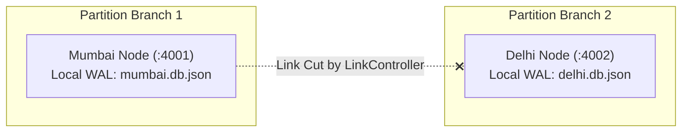
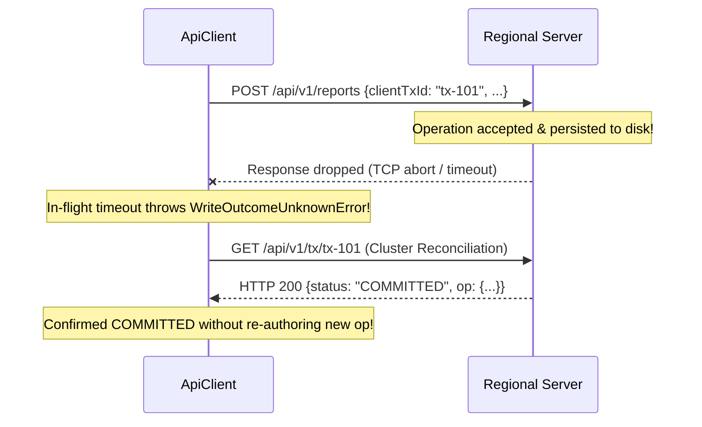

# VERDICT — Failure Scenarios & Recovery Analysis

This document details VERDICT's behavior across seven operational scenarios, grounded in the actual codebase, automated test suites, and running services.

---

## Scenario A — Normal Operation (Healthy Baseline)

### Runtime Behavior
1. **Local Writes:** When all links are connected (`LinkController.isLinkUp() === true`), a client write submitted to `POST /api/v1/reports` commits locally to `FileStore` in ~2–5 ms.
2. **Immediate Acknowledgment:** The client receives HTTP 200 with the newly assigned signed operation (`opId: 'mumbai:1'`) and folded entity state.
3. **Outbox Replay:** Within 1500 ms (one heartbeat step), `SyncEngine.stepHeartbeat()` drains the transactional outbox and forwards the operation to Delhi (`:4002`) and Bengaluru (`:4003`).
4. **Peer Acceptance:** Remote peers verify Ed25519 signatures, append the operation to their local stores, fold their local entity views, and return HTTP 200.
5. **Convergence:** The outboxes drain to 0. `GET /api/v1/convergence` computes canonical state hashes (`computeCanonicalStateHash`) across all entities and escrow allocations. Both hashes match identically, resulting in `CONVERGED`.

---

## Scenario B — One Regional Service Unavailable

### Behavior & Guardrails
- **Read Operations (`readWithFailover`):**
  - If the operator's preferred region (e.g. Mumbai, `:4001`) is down or returns HTTP 5xx, the client does not crash.
  - It deterministically follows `FALLBACK_RINGS['mumbai']`: tries `mumbai` &rarr; catches connection error &rarr; tries `delhi` (`:4002`).
  - Delhi answers with HTTP 200.
  - The response payload is labeled with `_servingRegion: 'delhi'` and `_isFailover: true`.
  - **UI Indication:** The top bar updates from `Serving Primary (MUMBAI)` to an amber badge: `Degraded Failover: Served via DELHI`.
- **Write Operations & Guardrails:**
  - Standard observations with `clientTxId` can route to the fallback node if the primary connection was refused before transmission began.
  - **Escrow Quota Fencing:** If an operator attempts to spend regional escrow via `spendEscrow('medical_kits', 2, 'mumbai')` while Mumbai is offline, the client **strictly refuses** to failover to Delhi or Bengaluru.
  - It throws `EscrowQuotaFenceError`:
    > *"Escrow quota fence: Cannot failover spendEscrow to another region. Quota is strictly bounded to authorized rights of [MUMBAI]."*
  - **Consistency Rationale:** Automatically rerouting a spend to Delhi would consume Delhi's local quota rather than Mumbai's, creating severe spatial supply deficits in disaster zones.
- **Decision Gate Evaluation:**
  - Evaluated on the fallback node, but explicitly stamped with `_evaluatingRegion: 'delhi'` and `_requestedRegion: 'mumbai'`. The gate's **Authority Reachability (Blind-spot rule)** triggers: if Mumbai is offline, Mumbai's territory assets trigger a `CAUTION` warning alerting responders that newer updates may exist remotely.
- **Complete Ring Failure:**
  - If all nodes in the ring are unreachable, `ApiClient` throws `AllRegionsUnavailableError`, surfacing a clear failure instead of pretending the request succeeded.

---

## Scenario C — Network Partition

### In-Memory Simulation Mechanism
Partitions are controlled via `LinkController`:
```typescript
linkController.cutLink('mumbai', 'delhi', true); // Cuts bidirectional communication
```



### Partition Behavior
1. **Local Writes Continue (AP Mode):**
   - Responders in Mumbai submit reports; Mumbai increments `localVector['mumbai']` and saves locally.
   - Responders in Delhi submit reports; Delhi increments `localVector['delhi']` and saves locally.
2. **Outbox Accumulation:**
   - Mumbai queues Delhi's copies in its outbox (`delhi:mumbai:seq`).
   - Delhi queues Mumbai's copies in its outbox (`mumbai:delhi:seq`).
   - Outbox items persist durably to disk in `data/*.db.json` across process restarts.
3. **Partition Ribbon Indicator:**
   - The web console polls `api.getStatus()` and `api.getMap()`.
   - When down links are detected, the amber **Partition Ribbon** activates:
     `DEGRADED: MUMBAI↔DELHI down — local writes OK, escrow-limited commitments`.
4. **Fog of Information:**
   - On the Operations Map, territories belonging to disconnected regions are veiled by an indigo-grey hatch pattern (`FogLayer.tsx`) with an elapsed contact timer, warning operators of observation decay.

---

## Scenario D — Conflicting Updates

### Real Test Fixture: `access-corridor-north`
In [`packages/region-service/test/failover.test.ts`](file:///c:/Users/Rohit%20Patil/OneDrive/Documents/Final_PrintWinners/packages/region-service/test/failover.test.ts) (Scenario 7) and [`scripts/run-demo.js`](file:///c:/Users/Rohit%20Patil/OneDrive/Documents/Final_PrintWinners/scripts/run-demo.js):

1. **Mumbai authors:** Status `OPEN` with causal vector `{ mumbai: 1 }`.
2. **Delhi authors concurrently:** Status `BLOCKED` with causal vector `{ delhi: 1 }`.
3. **Causal Vector Comparison:**
   [`compareVectors({ mumbai: 1 }, { delhi: 1 })`](file:///c:/Users/Rohit%20Patil/OneDrive/Documents/Final_PrintWinners/packages/core/src/vector.ts) evaluates both claims:
   - `v1` has greater in `mumbai`, `v2` has greater in `delhi`.
   - Returns `'concurrent'`.
4. **Deterministic Merge & Conflict Preservation:**
   - In [`foldOperations()`](file:///c:/Users/Rohit%20Patil/OneDrive/Documents/Final_PrintWinners/packages/core/src/policy.ts):
     Both claims are maximal under causal ordering. Neither dominates the other.
   - **Never Last-Write-Wins (LWW):** Neither claim is silently discarded.
   - The entity is flagged with `conflict.status = 'AWAITING_REVIEW'`.
   - Both claims are stored side-by-side in `entity.conflict.claims`.
5. **Conservative Fail-Safe Effective Status:**
   - For road entities, if any concurrent claim reports `BLOCKED`, the effective status is held at `BLOCKED` (fail-safe) to prevent dispatching convoys into dangerous roads.
6. **Reviewer Adjudication Workflow:**
   - The conflict appears in the **Review Inbox** (`ReviewInboxView.tsx`).
   - An authorized operator with reviewer role calls `POST /api/v1/conflicts/:id/resolve` with `{ status: 'OPEN', reason: 'Drone footage confirmed debris cleared' }`.
   - The resolution is signed, chained as a `RESOLVE` operation, and folded into `RESOLVED_BY_HUMAN`.

---

## Scenario E — Ambiguous Write Outcome (PROVE-ONCE)

### The In-Flight Timeout Dilemma
If a client transmits a write to Mumbai and the connection drops or times out after 4000 ms:
- Did the server commit the operation and only the HTTP response was lost?
- Or did the packet fail to reach the server?



### VERDICT Implementation
1. **Explicit `UNKNOWN` State:**
   [`ApiClient.writeWithIdempotency()`](file:///c:/Users/Rohit%20Patil/OneDrive/Documents/Final_PrintWinners/packages/web/src/api/client.ts) catches `AbortError` and throws `WriteOutcomeUnknownError`. Automatic blind retries are blocked.
2. **Transaction Status Query:**
   The server provides `GET /api/v1/tx/:clientTxId` to check local operation logs and outboxes.
3. **Cluster Outcome Reconciliation (`queryOperationOutcome`):**
   - The client queries the cluster.
   - If **any** contacted replica has the operation &rarr; returns `COMMITTED`.
   - If **all** cluster replicas respond and none have it &rarr; returns `NOT_COMMITTED`.
   - If candidate replicas were unreachable &rarr; returns **`UNKNOWN`** (an operation missing from one node is **never** falsely declared `NOT_COMMITTED` if peers could hold it).
4. **Idempotent Retry Safety:**
   If the client retries with the same `clientTxId`, `SyncEngine.submitLocalOp()` detects the existing transaction ID and returns the existing operation without appending a duplicate entry to the hash chain or incrementing the sequence number.

---

## Scenario F — Complete Regional Process or Storage Loss

### What Actually Happens
1. **Process Crash Simulation:**
   - If the Delhi process terminates, Mumbai notices peer unreachability during the next heartbeat.
   - Mumbai logs Delhi as `reachable: false`.
   - Delhi's updates remain queued in Mumbai's outbox file.
2. **Restart Recovery:**
   - When Delhi restarts (`node packages/region-service/dist/index.js`), `FileStore.init()` reads `data/delhi.db.json`.
   - All previously acknowledged operations, entity states, decisions, and outbox items are reloaded into memory.
   - Zero operations are lost from the persistent log.
3. **Local Standby Recovery Simulation:**
   - Tested via [`scripts/run-recovery-proof.js`](file:///c:/Users/Rohit%20Patil/OneDrive/Documents/Final_PrintWinners/scripts/run-recovery-proof.js) in an isolated OS temp directory.
   - Re-verifies all 7 acknowledged operations survive simulated storage outage and node restoration.

### Critical Limitations to Disclose
- **Host Failure:** If the host machine's drive fails, all local `data/*.db.json` files on that drive are lost unless backed up.
- **Not Cloud DR:** VERDICT is a local multi-process simulation. It does not use AWS S3 cross-region replication or multi-zone EBS snapshots.

---

## Scenario G — Reconnection and Convergence

### Reconnection Procedure
1. **Link Restoration:**
   `linkController.restoreLink('mumbai', 'delhi')`.
2. **Episode Lifecycle:**
   `SyncEngine.stepHeartbeat()` notices all links are up and initiates the conclusion of the active `PartitionEpisode`.
3. **Outbox Exchange:**
   Mumbai flushes its queued operations to Delhi; Delhi flushes its queued operations to Mumbai.
4. **Merge Report Generation:**
   [`SyncEngine.generateMergeReport()`](file:///c:/Users/Rohit%20Patil/OneDrive/Documents/Final_PrintWinners/packages/region-service/src/sync/sync-engine.ts) compiles a countable PR-style merge summary:
   - Operations created locally vs remotely.
   - Conflicts detected.
   - Bandwidth savings (measured delta transmission vs full-state replication).
5. **Canonical Convergence Verification:**
   - Both nodes compute canonical state hashes (`computeCanonicalStateHash`).
   - Hashes match identically across entities and escrow states.
   - Overall status reports **`CONVERGED`**.
