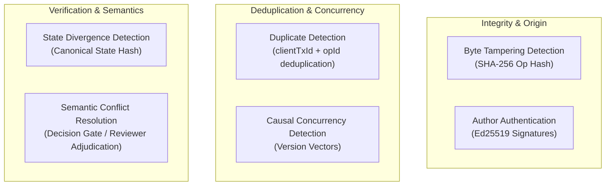

# VERDICT — Hashing, Cryptography & Consistency Model

This document specifies the exact cryptographic hash functions, digital signature protocols, causal vector models, and state verification mechanisms implemented in VERDICT.

---

## 1. Cryptographic Primitive Architecture

VERDICT uses five distinct cryptographic and consistency mechanisms. Each serves a distinct purpose in the distributed lifecycle:

| Mechanism | Primitive | Scope / Target | Purpose |
| :--- | :--- | :--- | :--- |
| **Operation Content Hash** | SHA-256 (`@noble/hashes`) | Canonicalized operation JSON | Detect byte tampering and payload alteration |
| **Operation Signature** | Ed25519 (`@noble/ed25519`) | Operation SHA-256 hash | Authenticate author origin and prevent identity forgery |
| **Hash-Chain Linkage** | SHA-256 pointer (`prevHash`) | Preceding operation hash | Ensure append-only immutability and log truncation detection |
| **Canonical State Hash** | Canonical JSON + SHA-256 | Normalized entities + escrow | Detect state divergence between replicas post-merge |
| **Causal Version Vectors** | Component-wise mapping | Per-region logical sequence | Order operations causally and detect concurrency |

---

## 2. Operation Hashing & Signing Pipeline

### A. SHA-256 Canonical Operation Hashing
- **File:** [`packages/core/src/crypto.ts`](file:///c:/Users/Rohit%20Patil/OneDrive/Documents/Final_PrintWinners/packages/core/src/crypto.ts)
- **Function:** `calculateOpHash(op: Omit<Operation, 'hash' | 'sig'>): string`
- **Exact Input Fields:**
  ```typescript
  const content = {
    opId: op.opId,           // e.g. "mumbai:4"
    region: op.region,       // e.g. "mumbai"
    seq: op.seq,             // e.g. 4
    type: op.type,           // e.g. "REPORT", "ESCROW_SPEND"
    entityId: op.entityId,   // e.g. "access-corridor-north"
    payload: op.payload,     // Object containing status, clientTxId, etc.
    deps: op.deps,           // Snapshot of VersionVector at creation time
    authorId: op.authorId,   // e.g. "operator-mum"
    authorRole: op.authorRole, // e.g. "OFFICIAL"
    createdAt: op.createdAt, // Millisecond epoch timestamp
    prevHash: op.prevHash    // 64-character hex hash of previous local op
  };
  ```
- **Serialization:** Formatted using [`canonicalJson()`](file:///c:/Users/Rohit%20Patil/OneDrive/Documents/Final_PrintWinners/packages/core/src/canonical.ts), which sorts all object keys recursively to guarantee byte-for-byte serialization determinism regardless of JavaScript engine object key insertion order.
- **Hash Output:** 64-character lowercase hexadecimal string stored in `op.hash`.

### B. Ed25519 Digital Signature
- **File:** [`packages/core/src/crypto.ts`](file:///c:/Users/Rohit%20Patil/OneDrive/Documents/Final_PrintWinners/packages/core/src/crypto.ts)
- **Functions:** `signHash()`, `verifySignature()`
- **Sign Input:** 32-byte binary decoded from `op.hash` signed with 32-byte regional private key (`SEED_PRIVATE_KEYS[region]`).
- **Signature Output:** 128-character hexadecimal string stored in `op.sig`.
- **Verification Rule:** Remote peers look up the author region's public key (`getPublicKey()`) and verify `verifySignature(op.hash, op.sig, pubKey)`. Any modification to a single bit of the payload, seq, or previous hash breaks signature verification, causing the peer to reject the operation with `{ status: 'invalid' }`.

### C. Hash-Chain Construction
- The first operation in a region's genesis log uses `prevHash: "0000000000000000000000000000000000000000000000000000000000000000"`.
- Each subsequent local operation reads `lastOp.hash` from `store.getOps()` and embeds it into `prevHash`.
- An attacker who modifies an old operation in `mumbai.db.json` cannot recompute the hash chain without re-signing every subsequent operation with the region's private key.

---

## 3. Canonical State Hashing (`computeCanonicalStateHash`)

### Implementation
- **File:** [`packages/core/src/convergence.ts`](file:///c:/Users/Rohit%20Patil/OneDrive/Documents/Final_PrintWinners/packages/core/src/convergence.ts)
- **Functions:** `computeCanonicalStateHash(entities, escrow)`, `normalizeEntityForCanonicalHash()`
- **Scope:** `"entities,escrow"`

### Normalization & Exclusion of Nondeterministic Fields
A major risk in distributed systems is comparing state hashes that differ solely due to local machine timing or wall-clock drift. VERDICT explicitly normalizes state:

```typescript
export function normalizeEntityForCanonicalHash(entity: Entity): any {
  return {
    entityId: entity.entityId,
    type: entity.type,
    authorityRegion: entity.authorityRegion,
    status: entity.status,
    attributes: entity.attributes || {},
    versionVector: entity.versionVector || {},
    participatingOpIds: Array.isArray(entity.participatingOpIds)
      ? [...entity.participatingOpIds].sort() // Sorted deterministically
      : [],
    integrity: entity.integrity || 'UNVERIFIED',
    conflict: entity.conflict ? { ... } : undefined
  };
}
```

**Explicitly Excluded Fields:**
- `lastObservedAt` (local physical arrival timestamp drift).
- `lastUpdatedAt` (local file mutation timestamp drift).
- Unordered claim arrays (claims are sorted by `opId` before hashing).

### Where Canonical Hashes Are Used
1. **Convergence API:** `GET /api/v1/convergence` (cross-node comparison) and `GET /api/v1/convergence/local` (lightweight local hash).
2. **Automated Test Suites:** [`packages/region-service/test/convergence.test.ts`](file:///c:/Users/Rohit%20Patil/OneDrive/Documents/Final_PrintWinners/packages/region-service/test/convergence.test.ts) (10 tests) and [`failover.test.ts`](file:///c:/Users/Rohit%20Patil/OneDrive/Documents/Final_PrintWinners/packages/region-service/test/failover.test.ts) (Scenario 11).
3. **Web Dashboard:** **Regions View** displays real-time canonical state hashes and peer comparison status.

---

## 4. Fundamental Distinctions (What Hashes Do and Do NOT Do)

To avoid unsupported claims during technical evaluation, recognize the strict boundaries of each mechanism:



### 1. Detecting Tampering vs Authenticating Signed Operations
- `calculateOpHash` proves the payload has not been modified since the hash was generated.
- `verifySignature` proves the hash was generated by someone possessing the designated regional private key.
- **Limitation:** A verified signature proves key origin; it does **not** prove that a field report is factually true in the real physical disaster world.

### 2. Detecting Duplicate Operations vs Causal Concurrency
- Deduplication relies on `clientTxId` and `opId` to prevent re-applying identical user submissions.
- Concurrency detection relies on `VersionVector` comparisons (`compareVectors()`) to determine whether two *different* submissions happened independently during a network partition.

### 3. Detecting Replica Divergence vs Resolving Conflicts
- **Canonical State Hashing** compares whether two replicas currently match bit-for-bit.
- **Hashes do NOT:**
  - Replicate missing data.
  - Determine which conflicting claim is true.
  - Automatically force convergence.
- If two replicas have different states, the hash simply exposes the discrepancy (`DIVERGED`). The actual resolution is achieved through outbox synchronization (`SyncEngine`) and reviewer conflict adjudication (`foldOperations`).
