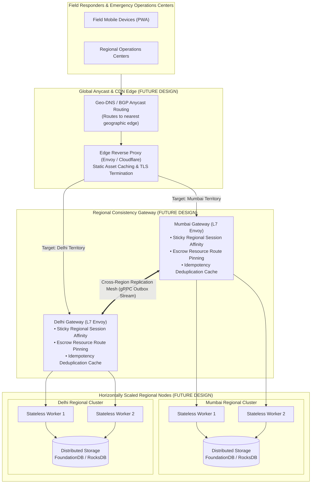

# VERDICT — Load Balancer Assessment & Production Scaling Architecture

This document answers the faculty/judge inquiry regarding how VERDICT supports more concurrent users, evaluates whether a load balancer exists in the current prototype, analyzes why conventional load balancing interacts non-trivially with consistency invariants, and proposes a production deployment architecture.

---

## 1. Current State: Does a Load Balancer Exist in the Prototype?

### Verdict: **NO.**
There is **no reverse proxy, Nginx, HAProxy, Envoy, AWS Application Load Balancer (ALB), or in-process load balancer** currently running in the VERDICT repository.

### Current Implementation Evidence
1. **Direct Port Addressing:**
   In [`packages/web/src/api/client.ts`](file:///c:/Users/Rohit%20Patil/OneDrive/Documents/Final_PrintWinners/packages/web/src/api/client.ts) (lines 100–108):
   ```typescript
   public ports: Record<Region, number>;
   constructor(public currentRegion: Region = 'mumbai', ports?: Partial<Record<Region, number>>) {
     this.ports = {
       mumbai: ports?.mumbai ?? 4001,
       delhi: ports?.delhi ?? 4002,
       bengaluru: ports?.bengaluru ?? 4003
     };
   }
   public getBaseUrl(region: Region = this.currentRegion): string {
     return `http://127.0.0.1:${this.ports[region]}`;
   }
   ```
   The browser initiates HTTP fetch calls **directly** to `http://127.0.0.1:4001`, `http://127.0.0.1:4002`, or `http://127.0.0.1:4003`.
2. **Client-Side Fallback Rings, Not Server-Side Balancing:**
   When an active node becomes unreachable, routing is handled on the client via `FALLBACK_RINGS` (`readWithFailover`), not via an intermediary reverse proxy.
3. **No Round-Robin Distribution:**
   Requests are sent to the operator's explicitly selected preferred region (`viewingRegion`). They are not spread across nodes to distribute CPU or memory load.

---

## 2. Why Conventional L4/L7 Load Balancing Breaks Consistency

A standard load balancer (e.g. AWS ALB using round-robin or least-outstanding-requests) **cannot** be dropped naively in front of VERDICT's regional nodes. Doing so would violate core operational invariants:

### A. Escrow Quota Fencing (`EscrowQuotaFenceError`)
- In VERDICT, consumable resources (medical kits, rescue boats) are bounded counters partitioned per region.
- If a responder requests 2 kits from Mumbai, the request **must** evaluate Mumbai's local quota.
- If a naive round-robin load balancer routed the request to Delhi, it would deduct from Delhi's supply quota. In a flood or disaster scenario, this would cause catastrophic supply misallocations.

### B. Territory Authority & Blind-Spot Evaluation
- Mumbai is the designated territory authority for Western Sector corridors (`access-corridor-north`).
- Dispatches evaluated against Mumbai are evaluated with authority reachability.
- If a load balancer routed one query to Mumbai and the next to Bengaluru (which might be temporarily partitioned from Mumbai), the responder would see conflicting `GO` and `HOLD` verdicts on alternating page refreshes.

### C. In-Flight Write Ambiguity & Retry Hazards
- If an ALB times out waiting for Mumbai's response, a default ALB retry rule would re-issue the write to Delhi.
- Unless the proxy preserves and checks the stable client transaction identifier (`clientTxId`), this blind retry could create duplicate operational side effects.

---

## 3. Minimal Production Scaling Architecture (Proposed Future Design)

To scale VERDICT to thousands of concurrent emergency responders across India without violating consistency rules, the architecture would evolve as follows:



### Necessary Changes for Production Scaling:
1. **L7 Routing with Route Pinning:**
   - Deploy an L7 reverse proxy (e.g. Envoy).
   - Route `/api/v1/escrow/spend` based on the URL parameter (`resource` home region) to ensure escrow spends always terminate at the quota owner.
2. **Session Affinity:**
   - Responders operating in Maharashtra pin their session to the Mumbai gateway, avoiding alternating replica views.
3. **Stateless Node Workers + Shared Regional Storage:**
   - Replace single-process `FileStore` with a shared clustered regional storage (e.g. embedded RocksDB or local FoundationDB cluster) behind horizontally scaled regional Fastify workers.
4. **Idempotency Proxy Layer:**
   - The edge gateway inspects `X-Client-Tx-Id` headers and returns cached committed receipts directly during network retries.
